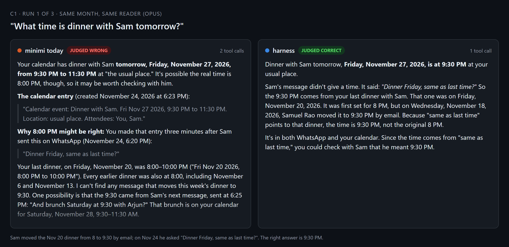
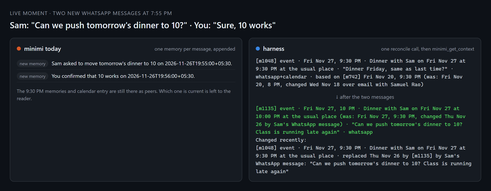
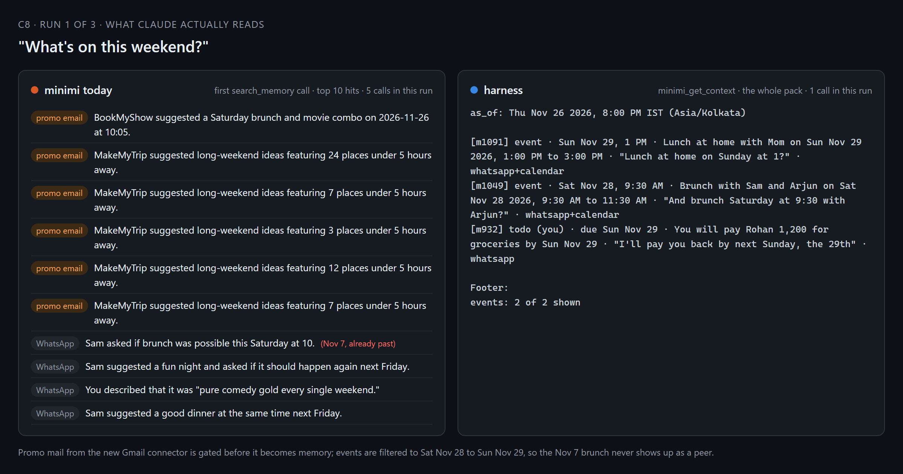

# minimi memory harness

A memory layer that sits between minimi's capture and the model that reads it.

minimi now has Gmail and Calendar connectors, so the same fact reaches memory from several places: the WhatsApp chat on screen, the email, the calendar invite. Some of those copies are stale, and a lot of promo mail comes along with them. If memory is an append-only pile, every new copy is one more near-duplicate that looks like the answer. The harness decides at write time what each new message changes, so the reader gets one current version with its history attached.

I tested it on a fictional month against a clone of minimi's connector shape. Same data, same reader (Claude Opus), same 8 questions, 3 runs each:

<p align="center"></p>

| | minimi connector shape | harness |
|---|---|---|
| Runs judged correct | 14 / 24 | 22 / 24 |
| Questions correct on all 3 runs | 4 / 8 | 6 / 8 |
| Tool calls per question | 4.9 | 1.7 |
| Tokens read from memory per question (estimate) | 4,319 | 1,085 |
| Answer time | 40.1 s | 33.6 s |

The token figure is characters of tool output divided by 4. Per-question numbers are in [SCORECARD.md](SCORECARD.md):

<p align="center"></p>

## What the difference looks like

**"What time is dinner with Sam tomorrow?"** Sam moved last week's dinner from 8 to 9:30 by email, then asked on WhatsApp "Dinner Friday, same as last time?". The baseline finds the old 8 PM calendar entries and hedges. The harness answers in one call and shows where 9:30 came from.



In the demo, Sam then pushes dinner to 10. The baseline appends two more lines next to the 9:30 ones. The harness replaces the memory, keeps 9:30 as history, and says what changed it.



For "What's on this weekend?", six of the baseline's top ten hits are promo mail from the Gmail connector, plus a brunch from three weeks ago. The harness hands over the whole answer in about 159 tokens.



## How it works

- **Write.** Raw messages are stored and deduplicated across capture paths, and promo mail is filtered out. Messages are grouped into bursts per thread. One LLM call per burst sees the burst plus up to 40 related memories and returns ops: `new`, `same`, `replaces`, `extends`, `ends`. Each op has to quote its source message word for word, and code checks the quote, target, people and time order before applying it.
- **Retrieve.** `minimi_get_context(question)` uses no LLM. It turns the question into filters ("this weekend", "what do I owe"), fuses vector, BM25 and filter results, drops near-duplicates, attaches one hop of history ("was 8 PM, changed by Sam's email"), and caps the result at 1,500 tokens.
- **Forget.** Nothing is deleted. Replaced and ended memories stay as history and only drop in ranking.
- **Dream.** A nightly pass expires old statuses, retries failed bursts, settles contradictions, closes stale todos against later evidence ("Thanks for calling" closes "call the landlord"), and merges near-duplicates.

The ideas come from Supermemory, Mem0, Zep, Letta's sleep-time agents and Chroma's context rot report. [docs/design.md](docs/design.md) has the full design and says which piece came from where.

After replaying the month, the store holds 61 lasting memories (5 open todos, 11 events, 14 facts, 31 preferences) plus a log of chat episodes. All 19 end-state checks in [`harness/score.py`](harness/score.py) pass: exactly the five real open todos, the four finished ones closed, the stale 8 PM invite never revived, and Priya's flight number kept on Priya.

## How it was scored, and the caveats

- The data is fictional. [`corpus/scenario_d.json`](corpus/scenario_d.json) is one person's month: 1,326 messages seen on screen, 354 emails from the Gmail connector (copies, about 300 promos with deliberate distractors like "Friday dinner for two at 8 PM"), and 8 calendar events, one of them stale.
- The baseline is my clone of minimi's connector shape. [`baseline/minimi_shape.py`](baseline/minimi_shape.py) exposes the same four tools as minimi's connector (`search_memory`, `list_active_threads`, `get_latest_context`, `meeting_memory`) over one memory per message, written by the same model the harness uses (gpt-oss-120b). It contains none of minimi's code.
- The reader is headless `claude -p` with Opus and only one side's connector enabled. The judge is also Opus and sees only the question, the rubric in [`corpus/scenario_c_questions.yaml`](corpus/scenario_c_questions.yaml) and the final answer, never the tool calls. I read every failed verdict by hand. The harness's two fails are date precision (a weekend deadline given as Saturday, a send date left out) and I counted them as fails.
- The corpus covers one person and one month. Bedrock isn't deterministic at temperature 0, so a fresh replay can land a check or two differently. Chat episodes are still stored and only fade in ranking.
- The last full replay of the month made 936 gpt-oss-120b calls on Bedrock in 52 minutes, under $1. Reads make no LLM calls.

## Run it

Needs Python 3.11 and AWS Bedrock access for the write path.

```powershell
git clone https://github.com/abhilashHQ/minimi-context.git; cd minimi-context
py -3.11 -m venv .venv; .\.venv\Scripts\Activate.ps1; pip install -e .
python -m corpus.scenario_d build
python -m harness.cli replay --corpus corpus/scenario_d.json --db runs/harness/d.db
python -m harness.cli ask --db runs/harness/d.db "What do I still owe people?"
python -m harness.server --db runs/harness/d.db    # MCP over stdio
```

[DEMO.md](DEMO.md) covers running both sides in Claude Desktop, the live moment, and rebuilding the scorecard. The images here are rendered from run data by `python -m docs.make_assets`.

## Repo map

| Path | What's there |
|---|---|
| [`harness/`](harness) | The memory layer: write, retrieve, dream, MCP server, CLI |
| [`baseline/`](baseline) | The minimi connector-shape baseline and its build |
| [`corpus/`](corpus) | Fictional scenarios, question rubrics, noise generator |
| [`runner/`](runner) | Headless question runs, the Opus judge, scorecard |
| [`tests/`](tests) | pytest suite |
| [`docs/`](docs) | Design doc, earlier search-only baseline ([p1-baseline.md](docs/p1-baseline.md)), image builder |
| [`SCORECARD.md`](SCORECARD.md) | Per-question results |
| [`SPEC.md`](SPEC.md) | Spec for a separate per-person context app on top of minimi's connector, not built in this repo |
